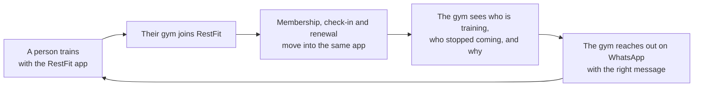

# RestFit — What It Is, What It Does, and How It's Different

Last updated: 2026-10-14

## What RestFit is

RestFit is a fitness app for Nigeria that anyone can use. It becomes more useful when your gym joins.

On its own, it's a personal training app. You log workouts, follow a training plan, build a streak and watch your progress. If your gym is on RestFit, the same app also holds your membership. You check in at the door with a QR code, renew from your phone, and keep memberships at more than one gym under one login.

Gym owners get a dashboard to run the business: members, payments, check-ins, and a list of members who are about to leave.

Tagline: **Rest. Train. Repeat.**

## Who it's for

| Who | What they use | Why they use it |
| --- | --- | --- |
| Anyone who wants to get fit | The RestFit app (Android) | A free coach and training diary. No gym needed |
| Gym members | The RestFit app, with their gym connected | Their membership, check-in and renewal all in the app they already train with |
| Gym owners and front desk staff | The RestFit gym dashboard (web) | Members, payments, check-ins, and keeping members from leaving |

## What the app does

### For anyone: a personal coach in your pocket

- **Training plans that tell you what to do today.** Choose one of 5 ready-made programs, from complete beginner to Strength 5×5. Or answer 4 questions (goal, days per week, equipment, session length) and AI writes a 4-week plan for you in about 5 seconds.
- **Today's workout on the home screen.** The app shows you today's session. Tap once and the workout opens already filled in. When you finish, the plan moves on to the next day. Rest days are part of the plan too.
- **Workout logging that helps you get stronger.** For every exercise, the app shows what you lifted last time and suggests the next weight to try. A rest timer starts on its own between sets. You can repeat your last workout with one tap, and the app celebrates when you set a new personal best.
- **A gentle mode for beginners ("First Rep").** If you're just starting out, the app keeps things simple. It counts a walk, a run, a dance class or a yoga session as a workout, because anything counts, even 10 minutes.
- **Streaks and progress.** Keep a daily streak going. You can also track your body weight and see charts of your weight, how much you lift each week, and how each lift is improving.
- **Works without signal.** Log a workout with no data connection and it saves once you're back online.
- **Find a gym.** See gyms near you, or invite your own gym to join RestFit with a ready-made WhatsApp message.

### For gym members: your membership in the same app

- **QR check-in.** Show the code at the door. It still works when you're offline.
- **Membership status.** See your plan and when it expires.
- **Renew from your phone.** No need to queue at the front desk.
- **More than one gym.** Belong to two or three gyms and manage all of them from one login.
- **WhatsApp reminders.** Get a reminder 7, 3 and 1 days before your membership runs out, and on the day it does.

### For gym owners: run the gym and keep your members

- **Members and plans.** Add and search members, and set up your own membership plans and prices.
- **Payments.** Record cash, bank transfer or POS payments, or send an online payment link.
- **Front-desk check-in.** Scan a member's QR code. Every scan is recorded, with whether entry was allowed and why.
- **Dashboard.** Revenue, active members, memberships about to expire, and today's check-ins.
- **Automatic renewal reminders.** RestFit sends members WhatsApp reminders before they expire, so staff don't have to chase renewals.
- **At-risk members.** See everyone who hasn't checked in for 10 days or more, sorted into three groups:
    - **Training elsewhere:** still working out in the RestFit app, but not at your gym.
    - **Lapsed:** no gym visits and no activity in the app.
    - **Never started:** joined but never came in.

  Each group comes with a suggested WhatsApp message you can send with one tap.
- **Free to try.** A 30-day free trial, then ₦25,000 a month. No setup fee.

## How the two sides work together

The member gets a useful app whether or not they belong to a gym. The gym gets data no other gym software has: whether a member who stopped coming in is still training somewhere else.

## How RestFit differs from existing fitness apps

The fitness apps people already use fall into three groups. Each covers part of what RestFit does. None of them cover all of it.

| | Global fitness apps (e.g. Strava, Fitbod) | Nigerian gym software (e.g. FirstRep, GymLinx) | Gym pass (e.g. PayGYM) | **RestFit** |
| --- | --- | --- | --- | --- |
| Useful to someone with no gym | Yes | No, the member app belongs to one gym | No | **Yes** |
| Workout logging and training plans | Yes | Some | No | **Yes, including AI plans** |
| Gym membership, check-in and renewal | No | Yes | Access only | **Yes** |
| Memberships at several gyms, one login | No | No | One pass for partner gyms | **Yes** |
| Gym owner dashboard | No | Yes | No | **Yes** |
| Shows a gym which absent members are still training | No | No | No | **Yes** |
| Built for Nigeria (₦ pricing, WhatsApp, works offline) | No | Yes | Yes | **Yes** |

### What makes RestFit different

1. **It's a real app on its own, not an add-on to gym software.** With most gym software, the member app only works for that one gym. RestFit is useful to anyone from the first day, and joining a gym adds more to the same app.

2. **One login for every gym.** Many Nigerians train at more than one gym, near home and near work. RestFit keeps all of those memberships in one place. Other apps tie you to one gym, or sell one pass instead of managing the memberships you already have.

3. **It can tell a gym which absent members are "training elsewhere."** Other gym software can only say a member stopped coming. RestFit can also tell whether that member is still working out, because they log workouts in the app. That changes the conversation. "We miss you, here's an offer" is right for someone who quit. It's wrong for someone who's still training, just somewhere else.

4. **A coach for people who don't have one.** Trainer-first products like FirstRep use AI to help trainers write programs for their clients. RestFit's AI writes the plan straight for the gym-goer, who answers 4 questions and gets a 4-week program.

5. **Beginners are welcome.** Global fitness apps assume you already know what you're doing. RestFit's First Rep mode counts walking, dancing and home workouts, and uses encouraging language. People who'd never open a strength-training app can still use it.

6. **Built for how Nigeria works.** Reminders and outreach go through WhatsApp, not email. Workouts and QR check-in still work when the network drops. Prices are in naira, and gyms can still record cash, transfer and POS payments.

## In short

RestFit is a fitness app anyone in Nigeria can use. When their gym joins, it also becomes the gym's membership and retention system. Global fitness apps have no link to the gym, and gym software has no app people use away from the gym. RestFit has both, so gyms can see what's really happening with their members.
